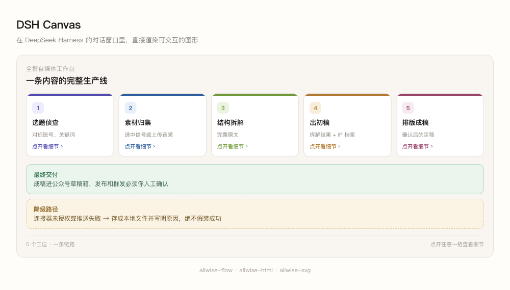

# DSH Canvas

让 DeepSeek Harness 的对话窗口直接渲染**可交互**的图形，而不是只给你文字或一张静态图片。

写一段代码块，它当场变成能点、能展开、能复制的界面；模型流式输出时，内容还会一格一格长出来。



## 装什么

一个 DSH 插件，包含两部分：

- **客户端渲染器**：把三种专用代码块渲染成交互组件
- **画布技能**：一份说明，让任何会话里的 AI 都知道该怎么画

装上插件，技能会自动出现在每个会话里，不需要另外配置，也不需要再教 AI 一遍。

## 三种画法

| 代码块 | 用来画什么 | 特点 |
|---|---|---|
| `allwise-flow` | 流程、步骤、生产线、工位卡 | 结构化，自动配色，每格可点开看输入输出 |
| `allwise-html` | 看板、对比表、带筛选的界面 | 任意 HTML + CSS + JS，沙箱运行 |
| `allwise-svg` | 示意图、关系图、时间线 | 原生矢量，随窗口缩放 |

## 用法

对着 AI 说「画个流程图」就行。它会在回复里直接画出卡片。

手写也可以，例如：

````
```allwise-flow
一条内容的完整生产线 | 每一格都点开看细节
触发 | 你主动发起
1 选题侦查 | 对标账号、关键词 → 雷达信号 | 扫描作品、算相对表现
2 素材归集 | 选中信号或上传音频 → 原文、转写 | 抓文案
交付 | 成稿进草稿箱，发布由你人工确认
降级 | 连接器失败就存本地并写明原因
```
````

## 安装

### 本地链接（开发用）

```bash
cd <你的 dsh profile 目录>
# package.json 的 dependencies 加：
#   "@local/dsh-canvas": "link:<本仓库的绝对路径>"
# dsh.profile.bundles 加：
#   "@local/dsh-canvas"
pnpm install
```

然后**完全重启** DSH。宿主侧的改动必须重启才生效。

### 验证

新开一个会话，让它画个流程图。看到可点的彩色卡片就是成功了。

## 设计说明

- **沙箱**：HTML 卡片运行在 `sandbox="allow-scripts"` 的 iframe 里，没有同源权限，拿不到对话内容、账号和本机数据。
- **高度自适应**：iframe 内部主动上报真实内容高度，展开和收起都会同步，不会出现内容被裁掉。
- **流式生长**：利用 `streaming` 状态，边写边画，而不是等全部写完才一次性出现。
- **源码可见**：每张卡片都能查看原始代码并复制。

## 结构

```
dsh/
├── client.js                     # 渲染器：FlowFenceLayer / HtmlFenceLayer
├── host.js                       # 注册画布技能
├── cordis.patch.yml              # 插件挂载声明
└── skills/allwise-canvas/
    └── SKILL.md                  # 给 AI 的画布说明
```

## 许可

MIT
